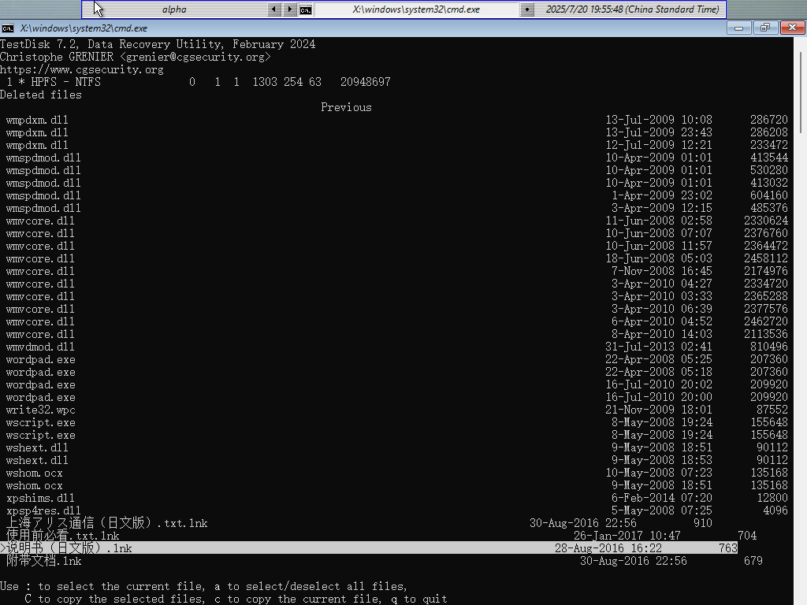
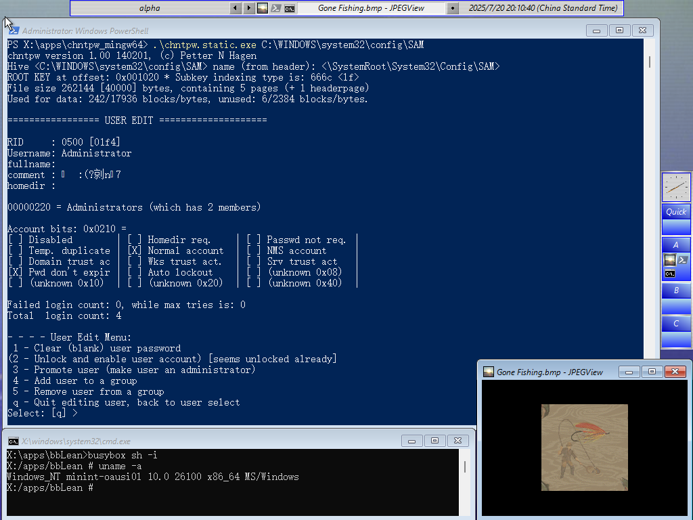

# My WinPE

## Description

This my personal [Windows PE (WinPE)](https://docs.microsoft.com/en-us/windows-hardware/manufacture/desktop/winpe-intro) build. It primarily reflects my personal interests. It is basically a vanilla WinPE build, with a simple blackbox style shell. It never intends to compete with those Linux LiveCDs, nor does it want to substitute for those "full featured" pre-built Windows PE images [wepe](https://www.wepe.com.cn),  [老毛桃winpe](https://www.laomaotao.net) or [Hiren's BootCD](https://www.hirensbootcd.org).

To name a few utilities included:

* [bbLean](http://bb4win.sourceforge.net/bblean/) that establishs an old-school user interface
* [busybox](https://frippery.org/busybox/) that yields some unix feel
* [Double Commander](https://doublecmd.sourceforge.io/) that replaces explorer.exe (which is not available in WinPE). I am including it because you can edit text files, read binary file in hex format, view images with this awesome utility.
* [TestDisk and PhotoRec](https://www.cgsecurity.org/) that covers disk and file recovery
* Offline NT Password & Registry Editor (https://pogostick.net/~pnh/ntpasswd/, link seems broken) that comes to rescue if you have to unlock your accidentally locked some Windows account or even blank its password in your thousands of virtual machines. A [Windows version of chntpw](https://github.com/y0umu/chntpw_mingw64) is ready for use.

There used to be some useful but non-FOSS applications. Parts of them are not included any longer. Check `my-winpe.cmd` and take a look at the lines that are commented out.

## Screenshots





## Pre-built image

Check [release page](https://github.com/y0umu/My-WinPE/releases).

Please take note that I put these ISO images on release page for **my personal convenience only**.
By downloading the ISO images, you agree that you are using them at your own risk, being legal or technological.

## Useful tricks

### Unlock bitlocker

Assume you have backed up your bitlocker keys/passwords in advance, you can unlock with

```cmd
manage-bde -unlock D: -rk E:\path\to\your\key
```

or

```cmd
manage-bde -unlock D: -rp YOUR-BITLOCKER-PASSWORD
```

### Update Intel Management Engine (Intel ME)

Find the driver provided by your motherboard manufacturer. You can find an example at `update_me.cmd`. 

### Reboot WinPE
Due to the mechanism of `winpeshl.exe`, you need to terminate the last running process listed in `%SYSTEMROOT%\System32\winpeshl.ini` to reboot. For my build, that is bbLean/Blackbox. To do so, right click the desktop and locate Blackbox > Quit. You can as well run `wpeutil reboot`.

## How to build this WinPE image

You probably need a legal copy of Windows to proceed. Generally, you should follow these steps:

1. Install ADK **and** ADK Windows PE Addon. Follow this documention on [ADK](https://learn.microsoft.com/en-us/windows-hardware/get-started/adk-install).
2. Open a terminal with administrative privilege and run `C:\Program Files (x86)\Windows Kits\10\Assessment and Deployment Kit\Deployment Tools\DandISetEnv.bat`.
3. Run `copype amd64 WinPE_amd64`.
4. Check and modify `my-winpe.cmd`. Obtain the utilities you need. Then run `my-winpe.cmd`.
5. Optionally test your image in a virtual machine.
6. Write it to a flash disk with `MakeWinPEMedia /ufd WinPE_amd64 J:` (assuming your flash disk has drive letter J). Or you could use [ventoy](https://www.ventoy.net).

**Notice** If you use `MakeWinPEMedia`, the partition table of your flash disk has to be MBR, otherwise `MakeWinPEMedia /ufd` [would fail](https://docs.microsoft.com/en-us/answers/questions/249767/makewinpemedia-fails-for-me.html).

### Other useful links

The Arch Wiki page on Windows PE: https://wiki.archlinux.org/title/Windows_PE